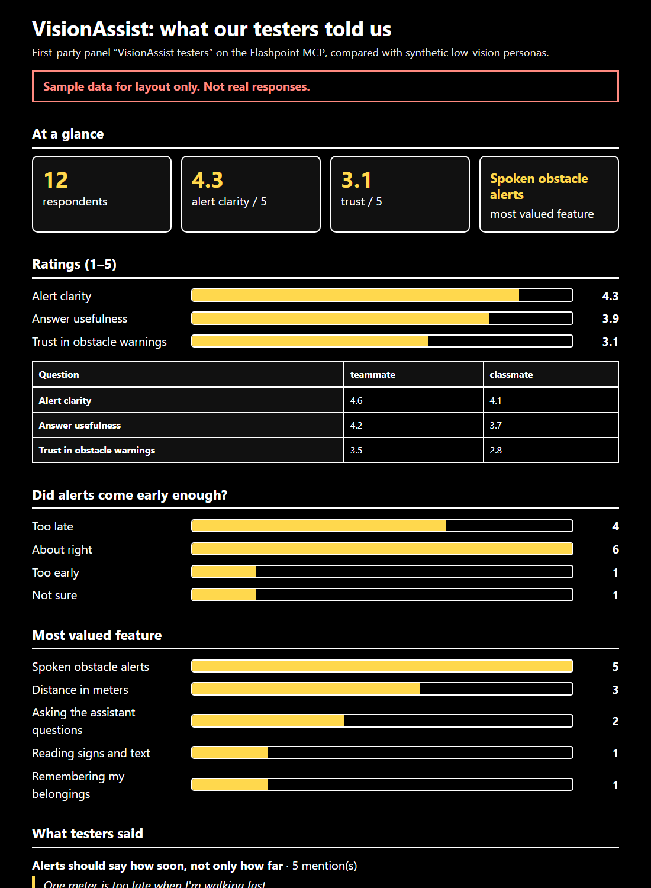

# VisionAssist Research Agent

**One conversation with Claude Code runs a complete, mixed-methods user study on the Flashpoint MCP, then turns the findings into engineering work.**

We build **VisionAssist**, a student prototype that helps people with low vision: two phone cameras and a laptop detect obstacles, speak alerts like *"Caution, chair straight ahead, about 1 meter"*, and a local LLM answers *"What is in front of me?"*. Before our final demo we needed evidence, not opinions. This agent gets it:

| Stage | Flashpoint tool | What it gives us |
| --- | --- | --- |
| 1. Context | `demographics` | Who VisionAssist serves: adults with a vision difficulty in New York (census-backed) |
| 2. Real testers | `tool_survey` first-party panel | A survey emailed to classmates and teammates who agreed to take part, tracked to results |
| 3. Synthetic low-vision users | `panel` create_and_run | AI personas of low-vision adults answer the same survey |
| 4. Compare | `tool_survey` | Where sighted testers and synthetic low-vision users agree and disagree |
| 5. Depth | `tool_qual` | AI-moderated interviews: when should an alert speak, what builds trust |
| 6. Act | local + `presentation` | A ranked VisionAssist roadmap, an accessible results dashboard, optional GitHub issues, and a .pptx deck |



*The dashboard is built for the people the product serves: large type, high contrast in dark mode, real headings and labelled bars for screen readers. Shown with sample data ([HTML](docs/sample-dashboard.html), [roadmap](docs/sample-roadmap.md)).*

## An MCP on top of the MCP

The agent is itself an MCP server (`mcp-server.mjs`). Open Claude Code in this folder and `.mcp.json` connects it automatically:

| Tool | Cost | Purpose |
| --- | --- | --- |
| `research_plan` | free | Pipeline status, next step, credit spent |
| `research_step` | per step | Runs one stage (context, panel, draft, publish, preview, send, report, results, synthetic, compare, interview, roadmap, deck, …) |
| `research_confirm` | $0.50 | Confirms publishing, emailing or interview invitations (marked destructive) |
| `research_artifacts` | free | Reads the roadmap and summary back into the conversation |

The approval gates survive the wrap. A paid step answers `NEEDS_APPROVAL: … costs $0.50` until the client calls again with `approve_spend: true` after asking its user. Sending emails needs the panel's exact name on both the request and the confirm.

```
You ─▶ Claude Code ─MCP─▶ visionassist-research (this repo) ─MCP over x402─▶ Flashpoint
          ▲                 research_plan / step / confirm / artifacts         demographics, tool_survey,
          └── asks you before spending, publishing or emailing ──┘             panel, tool_qual, presentation
                                     │
                                     └─▶ results/: summary, results.json, compare, interviews, roadmap.md, dashboard.html, deck link
```

## Safety by design

| Gate | Behaviour |
| --- | --- |
| Spending | Anything over $0.10 stops with the price (CLI exit code 3, MCP `NEEDS_APPROVAL`) until approved. |
| Publishing | `publish` only asks Flashpoint; a separate confirm publishes. |
| Emailing people | `send` and the confirm both need the panel's exact name; run `preview` first for the sendable count. Interview invitations work the same way. |
| Privacy | Emails are masked in all output, logs, saved results and the deck context. `panel.csv`, `state.json`, `runs/`, `results/` are git-ignored. |
| Consent | Only people who agreed go on the panel; every email carries an unsubscribe link; paid recruitment of strangers is never used. |
| Wallet key | Never printed or committed. Without a wallet the agent refuses to connect instead of silently creating one. |

## Run it

Requirements: Node.js 22.19+ (required by the locked HTTP client) and a Flashpoint hackathon wallet key. Copy `.env.example` to `.env` in the repository root, then fill in `FLASHPOINT_WALLET_KEY` locally before running the wallet commands. Git ignores `.env`.

```sh
npm install
node flashpoint.mjs balance                # free: credit check
cp panel.example.csv panel.csv             # real testers who agreed: name,email,role
node survey-agent.mjs plan                 # free: pipeline and next step
```

Then either talk to Claude Code ("Run the VisionAssist research study for my testers") or step through the CLI. Each paid step needs `--yes`:

### Start with a high-level objective

In Claude Code, try “Find out which spoken obstacle alert we should improve first and why. Use the consenting testers in panel.csv and wait for at least three replies before concluding.” The agent passes the objective to the `draft` step, and Flashpoint selects questions and response options for that objective. For the CLI workflow below, replace the `draft` command with:

```sh
node survey-agent.mjs draft --objective "Which spoken obstacle alert should we improve first and why?" --min-responses 3 --yes
```

Omit `--min-responses` to allow an answer after one real reply. The objective persists across sessions. Once the survey is sent, `results` checks the count against the threshold. If replies are still coming in, rerun it later in the same study directory. Each check costs $0.50. On completion, `results/answer.md` contains the original objective, direct answer, real reply count, evidence and limitations. Claude Code can read it through `research_artifacts`.

### Let the agent run a second round

Once a real first-round objective answer is available, ask Claude Code to follow up if the first-round evidence leaves a decision unresolved. The agent will draft 2–4 questions focused on that gap, or save its reason for skipping. The follow-up uses the existing panel, subject to approval to contact those testers again.

```sh
node survey-agent.mjs followup --yes
node survey-agent.mjs plan --round 2
node survey-agent.mjs publish --round 2 --yes
node survey-agent.mjs confirm --round 2 --step publish --yes
node survey-agent.mjs preview --round 2 --yes
node survey-agent.mjs send --round 2 --panel "VisionAssist testers" --yes
node survey-agent.mjs confirm --round 2 --step send --panel "VisionAssist testers" --yes
node survey-agent.mjs results --round 2 --yes
```

For MCP, call `research_step` with `step: "followup"`, then pass `round: 2` to subsequent steps and confirmations. Each Flashpoint call still needs spending approval. The second round inherits the first-round response threshold. The decision and combined answer are written to `results/followup/results/decision.json` and `results/followup/results/answer.md` and are available through `research_artifacts`.

### CLI steps

```sh
node survey-agent.mjs context --yes
node survey-agent.mjs panel --csv panel.csv --name "VisionAssist testers" --yes
node survey-agent.mjs draft --yes
node survey-agent.mjs publish --yes  &&  node survey-agent.mjs confirm --step publish --yes
node survey-agent.mjs preview --yes
node survey-agent.mjs send --panel "VisionAssist testers" --yes
node survey-agent.mjs confirm --step send --panel "VisionAssist testers" --yes
node survey-agent.mjs report --yes  &&  node survey-agent.mjs results --yes
node survey-agent.mjs synthetic -n 20 --yes  &&  node survey-agent.mjs compare --yes
node survey-agent.mjs interview --yes      # or: skip-interview
node survey-agent.mjs roadmap              # free: results/roadmap.md + results/dashboard.html
node survey-agent.mjs deck --yes
node survey-agent.mjs issues --repo Ai-gogogo/Visual-Obstacle-Avoidance        # dry run; --yes creates them
```

`node survey-agent.mjs next` runs whatever stage comes next and stops at every gate.

**Cost:** about $5 for the full study (≈ 8 survey/interview steps at $0.50, census $0.05, synthetic panel $0.60, deck $0.25). Emails are free.

## Tests

```sh
npm test
```

15 offline tests with a fake Flashpoint client (no wallet, no network, no credit): spending gate, census context, email masking in output and logs, survey conversation continuity, publish and send confirmations, objective-driven drafts and answers, evidence-driven follow-ups, structured results, the synthetic → compare → roadmap → dashboard → deck chain, interview invitations, roadmap ranking, dry-run issues, and the MCP server driven by a real MCP client over an in-memory transport.

## Files

- `agent.mjs` — the research pipeline and its gates (shared by CLI, MCP server and tests)
- `mcp-server.mjs`, `.mcp.json` — the MCP server
- `survey-agent.mjs` — CLI, GitHub issues, sample dashboard
- `report.mjs` — structured-result parsing, roadmap ranking, accessible dashboard
- `survey-brief.md`, `interview-brief.md` — the study instruments
- `flashpoint.mjs` — the organizers' x402 starter, unchanged
- `CLAUDE.md` — how Claude Code must drive the agent

## Demo (2–3 minutes)

1. VisionAssist speaks an obstacle alert and answers "What is in front of me?" (10 s).
2. In Claude Code: "Run the VisionAssist research study." It pulls census context, creates the panel, shows the drafted survey.
3. Approve publishing, check the sendable count, approve sending. Show a tester's email with its unsubscribe link.
4. "Summarise the results by role, then compare with synthetic low-vision users." Show where they disagree on trust and timing.
5. "Turn it into a roadmap." Open the dashboard; show the top fix and the issue it opened in the VisionAssist repo.
6. Close on one change we shipped because of the study.

## Limitations

- Most testers are sighted classmates; synthetic low-vision personas point to gaps but do not replace low-vision participants.
- Flashpoint agents reply in prose; the agent asks for a tagged JSON block and falls back to the text when it is missing. Raw replies (masked) stay in `runs/`.
- VisionAssist is a research demo, not a validated mobility aid.
